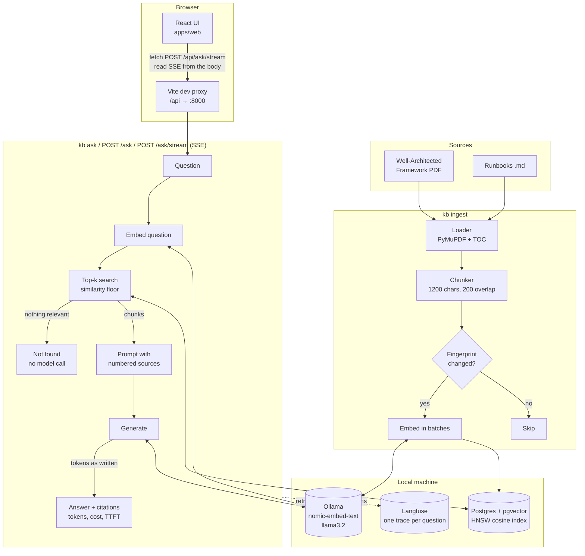
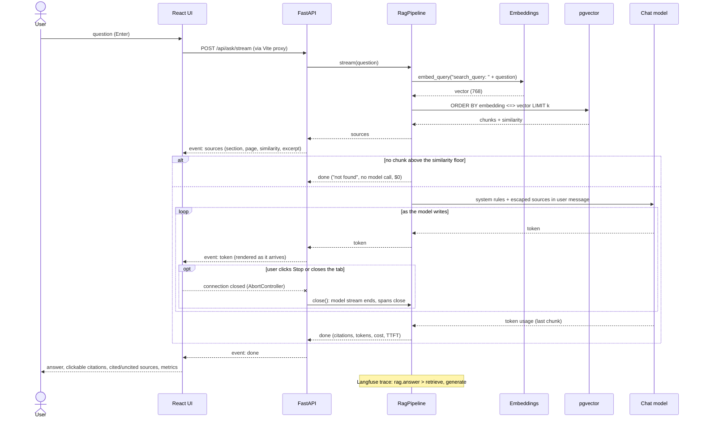
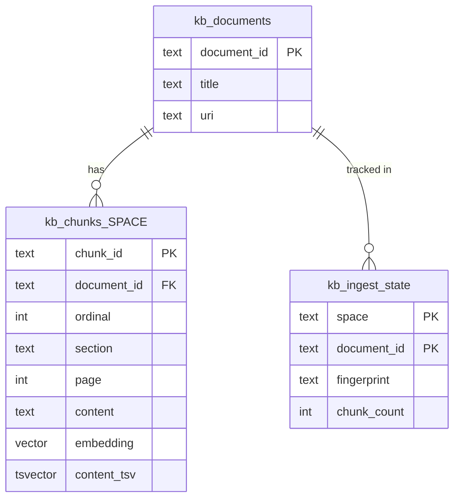
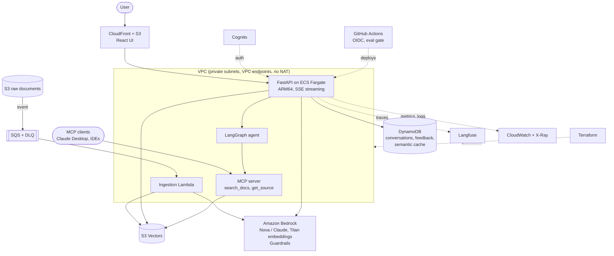

# Architecture

Diagrams are Mermaid, so GitHub renders them and they change in the same commit
as the code. Two views:

- **Current state:** what exists in the repo today. Updated at the end of every phase.
- **Target:** where the project is heading. Changes only when a decision changes.

---

## Current state: Phase 2b (fully local, streaming, traced, web UI)

### Ask: sequence

### Data model

`SPACE` is the embedding space, for example `ollama_nomic_embed_text_768`.

---

## Target architecture (end of Phase 8)

