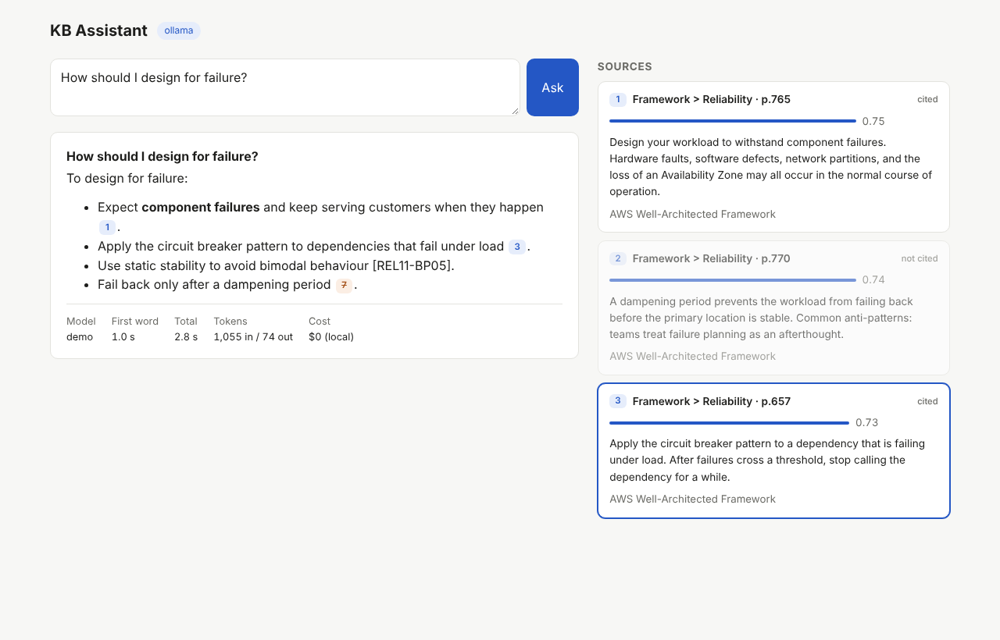

# Phase 2b: A web UI for streaming answers

**Time:** half a day. **AWS cost:** $0 (runs locally; hosting comes in Phase 6).

**You finish with:**

- A React page where the answer appears word by word, with a Stop button.
- Citations you can click: `[1]` highlights source 1 and its excerpt.
- Citations checked in the UI: a number that was never retrieved is struck through, and
  sources the answer didn't cite are dimmed.
- Model, time to first word, total time, tokens and cost under every answer.
- The API stops generating (and stops spending tokens) when the user clicks Stop or closes the tab.
- A demo mode that runs the real API with a scripted answer, for UI work without Ollama.



---

## Part 1: Concepts

### 1. Reading a stream in the browser

There are two ways to consume Server-Sent Events in a browser:

| | `EventSource` | `fetch` + stream reader |
|---|---|---|
| Method | GET only | Any (we use POST) |
| Request body | None: the question would go in the URL | JSON body |
| Headers | None (no `Authorization`) | Any |
| Reconnects | Automatic | Ours to handle (we don't need it) |
| Stop | `close()` | `AbortController` |

We need POST and, from Phase 2c, an `Authorization: Bearer` header for Cognito. So the UI
calls `fetch`, takes `response.body` (a `ReadableStream` of bytes), and parses SSE itself
(`src/lib/sse.ts`). The parser is about 60 lines, and the tests cover the hard parts:

- A network chunk can end anywhere, even mid-line. The parser keeps the unfinished line.
- A `\r\n` line ending can be split between two chunks.
- A UTF-8 character can be split across two chunks. `TextDecoder` with `{ stream: true }`
  keeps those bytes until the character is complete (the test uses the "ffl" ligature from
  investigation 0001).

### 2. Same origin: no CORS

The browser blocks a page on `localhost:5173` from reading responses from `localhost:8000`
unless the API sends CORS headers. Instead of configuring CORS, the UI only ever calls its own
origin, `/api/...`:

- **Development:** Vite's dev server forwards `/api/*` to `http://127.0.0.1:8000` (see `vite.config.ts`).
- **AWS (Phase 6):** CloudFront serves the static UI from S3 and routes `/api/*` to the API.

Same code, no CORS settings to get wrong (for example allowing every origin with credentials).

### 3. Model output is untrusted

The answer is generated from retrieved documents, and a document can contain injected
instructions (Phase 1, OWASP LLM01). If the model is tricked into writing
`` and the UI inserts it as HTML, that becomes cross-site scripting.

So the UI never inserts model output as HTML. `src/lib/citations.ts` turns the text into
paragraphs, lists, bold text and `[n]` markers, and React renders each as an element. React
escapes text, so HTML in the answer shows up as visible characters. There's a test for that.

### 4. The answer as a state machine

```
idle → retrieving → generating → done
                  ↘ error, stopped
```

`useAsk` keeps one state object and changes it with a reducer, one action per stream event.
A new question aborts the one in flight. That keeps the edge cases small and testable:
a late token from an old question can't land in a new answer.

### 5. Stopping saves money

Clicking Stop aborts the `fetch`. The browser closes the connection, and the API notices
between tokens (`stop_on_disconnect` in `main.py`). It then closes the pipeline generator,
which ends the model stream and closes the tracing spans. Without this, an abandoned answer
keeps generating to the end. That's free on Ollama, but every output token is billed on Bedrock.

---

## Part 2: What changed in the repo

| Path | What |
|---|---|
| `apps/web/` | New: Vite + React 19 + TypeScript (strict). |
| `apps/web/src/lib/sse.ts` | SSE parser and `readSSE()` for `fetch` bodies. |
| `apps/web/src/lib/api.ts` | `askStream()` (async generator of typed events), `getHealth()`, readable errors from FastAPI's `detail`. |
| `apps/web/src/lib/citations.ts` | Answer text → paragraphs, lists, bold, `[n]` citations. |
| `apps/web/src/hooks/useAsk.ts` | Reducer + `AbortController`: ask, stop, cancel on a new question or on leaving the page. |
| `apps/web/src/components/` | `AskForm` (Enter to ask, Shift+Enter for a new line), `AnswerText`, `SourceList`, `Metrics`. |
| `apps/web/src/**/*.test.ts(x)` | 28 tests: parser, API client, citations, reducer, and the whole page against a fake server. |
| `apps/api/src/kb_api/main.py` | `sources` events now include a 300-character `excerpt`; `stop_on_disconnect`; logging configured. |
| `scripts/demo_api.py` | The real API with a scripted, delayed answer. Includes a struck-through `[7]` citation on purpose. |
| `pyproject.toml` | `apps/web` excluded from the uv workspace (it matches `apps/*` but isn't a Python package). |
| `Makefile` | `web-setup`, `web-dev`, `web-demo`, `web-lint`, `web-test`, `web-build`; `setup` installs web deps too. |
| `.github/workflows/ci.yml` | New `web` job: Prettier, oxlint, TypeScript, tests with coverage, build, `npm audit`. |
| `.github/dependabot.yml` | npm updates for `apps/web`, grouped, 5-day cooldown. |
| `docs/adr/0020-web-ui.md` | The decisions in this phase. |
| `docs/architecture/README.md` | Current state: browser and proxy added; the sequence diagram shows Stop. |

---

## Part 3: Step by step

### Step 1: Apply and install (10 min)

```bash
cd ~/Projects/kb-assistant
git checkout main && git pull
git checkout -b phase-2b
unzip -o ~/Downloads/kb-assistant-phase2b.zip -d .
uv sync
make web-setup          # npm ci: exact versions from package-lock.json
make lint test          # Python: 79 passed, 8 skipped
make web-lint web-test  # Web: 28 passed, coverage ~98% of lines
```

`node -v` should print v22 or later (installed with fnm in Phase 0).

### Step 2: The UI with the demo API (10 min)

```bash
make web-demo   # terminal 1: API on :8000 with a scripted answer
make web-dev    # terminal 2: UI on http://localhost:5173
```

Open http://localhost:5173. The header pill says **demo** and every answer is the same
scripted one, whatever you ask: this mode tests the UI, not the model. Try:

1. **"How should I design for failure?"** Sources appear first, then the answer writes itself.
2. **Click a citation** such as `1`: the matching source gets a blue outline.
3. **Look at `7`:** struck through, because only three sources were retrieved. Hover it.
   `[REL11-BP05]` stays plain text: it isn't a source number (investigation 0001, section 5.2).
4. **Source 2** is dimmed and marked "not cited".
5. **"What's the weather today?"** The not-found message, 0 tokens, $0.
6. **Ask again and click Stop** mid-answer. The partial answer stays and the status says "Stopped."
   Terminal 1 logs `INFO:kb_api: client disconnected; generation stopped early`.
7. **Switch your Mac to dark mode.** The page follows it.

### Step 3: The real pipeline (10 min)

Stop the demo API (Ctrl+C in its terminal) and run the real one. The pill should now
say **ollama** and the Model under each answer **llama3.2**:

```bash
make up                 # Postgres
make api                # terminal 1 (Ollama must be running)
make web-dev            # terminal 2, if not still running
```

Ask the same questions. Things to notice:

- **The provider pill** in the header comes from `/health` (`ollama`, later `bedrock`).
- **"First word" vs "Total"**: the time to first word is what the user feels.
- **Struck-through citations are now real model mistakes.** Note how often llama3.2 makes
  them. Phase 3 turns this into a citation-accuracy score.
- **Langfuse** (if running): stop an answer early and open its trace. The `generate` span is
  cut short, with fewer output tokens.

### Step 4: Look at the stream in DevTools (5 min)

Open DevTools → Network, ask a question, and click the `stream` request:

- **Request:** `POST /api/ask/stream` with a JSON body; the question is not in the URL.
- **Response headers:** `content-type: text/event-stream`, `cache-control: no-cache`.
- **Timing:** "Waiting for server response" is retrieval; "Content download" lasts until the last token.

Chrome's EventStream tab only appears for `EventSource`, not for `fetch` streams. To see the
raw events, use `curl -N` as in Phase 2a, now through the proxy:

```bash
curl -N -X POST localhost:5173/api/ask/stream -H 'content-type: application/json' \
  -d '{"question":"How should I design for failure?"}'
```

### Step 5: Production build (5 min)

```bash
make web-build
ls -lh apps/web/dist/assets   # ~230 KB JS (~72 KB gzipped), ~4 KB CSS
```

That folder is the whole UI: static files. Phase 6 puts it in S3 behind CloudFront.

### Step 6: Commit

```bash
git add -A
git commit -m "Phase 2b: React UI with streaming answers, checked citations and Stop"
git push -u origin phase-2b
gh pr create --fill && gh pr checks --watch
gh pr merge --squash
```

CI now has four jobs: python, web, terraform, secrets.

---

## Part 4: Trade-offs

| Decision | Chosen | Alternative | Why |
|---|---|---|---|
| Framework | Vite + React SPA | Next.js | Static hosting (S3 + CloudFront, cents a month); no SSR or SEO needed |
| Stream client | `fetch` + own SSE parser | `EventSource`; `fetch-event-source` library | POST + auth headers; the parser is small and fully tested |
| API access | Same origin (`/api` proxy) | CORS | No CORS settings to get wrong; same paths in dev and AWS |
| Rendering answers | Own parser → React elements | `react-markdown`; `innerHTML` | Model output is untrusted; citations need custom handling anyway |
| Citation display | Checked against retrieved sources | Render whatever the model writes | Makes model errors visible instead of hiding them |
| State | `useReducer` + `AbortController` | Redux, Zustand, React Query | One screen, one stream; nothing to share across pages |
| Styling | Plain CSS with variables | Tailwind, component library | One screen; no extra build step; dark mode in a few lines |
| Lint/format | oxlint + Prettier | ESLint | Vite's template default; very fast; enough rules for this size |
| Response types | TypeScript interfaces | Runtime validation (zod) | Both sides in one repo with tests; add zod if other clients appear |

---

## Part 5: Interview hooks

1. *"How do you stream LLM output to a browser?"* SSE over a POST, read with `fetch` and a
   stream reader: `EventSource` can't send a body or auth headers. Handle chunks split
   mid-line and mid-character. Send sources first, then tokens, then a final event with usage.
2. *"How do you render LLM output safely?"* Treat it as untrusted: it can carry injected
   content from retrieved documents. Never insert it as HTML; parse the little formatting
   you need into elements. Same reason you escape it inside the prompt.
3. *"How do you make citations trustworthy in the UI?"* Only link citations that match a
   retrieved source; flag the rest. Show the excerpt and similarity score, and mark sources
   the answer didn't use. Then measure citation accuracy offline (Phase 3).
4. *"What happens when a user abandons a streaming request?"* The client aborts, the server
   detects the disconnect between tokens and closes the model stream. Otherwise you keep
   paying for output nobody reads.
5. *"Why no CORS?"* Same-origin routing (dev proxy, CloudFront path behaviour) removes a
   whole class of misconfiguration and works the same in every environment.

**Resume line:** "Built a React + TypeScript streaming UI for a RAG assistant: SSE over fetch
with a tested parser, citations validated against retrieved sources, safe rendering of model
output, and server-side cancellation that stops token spend when users abandon an answer."

---

## Part 6: Done checklist

- [ ] `make lint test` and `make web-lint web-test` pass
- [ ] Demo mode: streaming, clickable and struck-through citations, not-found, Stop
- [ ] Real pipeline: an answer from Ollama in the UI; "client disconnected" logged after Stop
- [ ] `make web-build` produces `apps/web/dist`
- [ ] Merged through a PR with all four CI jobs green

**Next: Phase 2c.** Cognito sign-in (Terraform), token checks in the API, the
`Authorization` header in `askStream()`, and the switch to Bedrock once the quota is raised.
